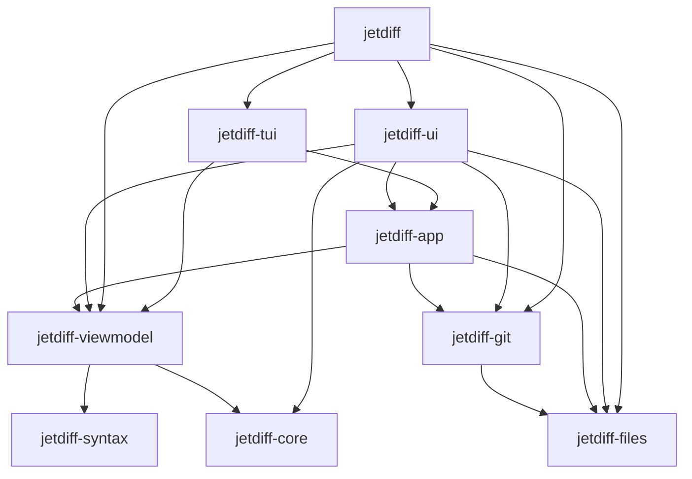

# Development

Requirements:

- Rust: the version in `rust-toolchain.toml`, which rustup installs by itself (edition 2024)
- For the golden generator: JDK 25 and Gradle 9.x

```
cargo run --release -p jetdiff -- examples/kotlin/a.kt examples/kotlin/b.kt
cargo test
```

`examples/` has a file pair per language to try the viewer on.

GPUI is built with `runtime_shaders`, so the Metal shaders are compiled at startup and Xcode's Metal Toolchain isn't needed.

How the code is organized is in [CODING_STANDARDS.md](CODING_STANDARDS.md). The domain language is in [GLOSSARY.md](GLOSSARY.md).

The code is split into crates with one responsibility each. Only `jetdiff-ui` and the binary know GPUI, and only `jetdiff-tui` knows the terminal. All the logic for scroll, folding and geometry is in `jetdiff-viewmodel`, and the state around the diff (the repo source, tree and commits) is in `jetdiff-app`. Both are tested without a window.



| Crate                                           | Responsibility                                                    |
| ----------------------------------------------- | ----------------------------------------------------------------- |
| [`jetdiff`](crates/jetdiff)                     | The binary: arguments and window                                  |
| [`jetdiff-ui`](crates/jetdiff-ui)               | The GPUI view                                                     |
| [`jetdiff-tui`](crates/jetdiff-tui)             | The terminal view                                                 |
| [`jetdiff-app`](crates/jetdiff-app)             | The state around the diff, without a GUI: repo source, tree, commits, config |
| [`jetdiff-viewmodel`](crates/jetdiff-viewmodel) | View model without a GUI: scroll, folding, cursor, keys           |
| [`jetdiff-core`](crates/jetdiff-core)           | The diff algorithm, ported from IntelliJ                          |
| [`jetdiff-syntax`](crates/jetdiff-syntax)       | Syntax colors with tree-sitter                                    |
| [`jetdiff-git`](crates/jetdiff-git)             | Changed files, file content and commits from `git`                |
| [`jetdiff-files`](crates/jetdiff-files)         | Changed files and the tree they are shown in                      |

Other folders:

- `fixtures/`: test cases for the diff algorithm, with expected results from IntelliJ. See [`fixtures/README.md`](fixtures/README.md)
- `tools/golden/`: the Kotlin generator that produces the expected results. See [`tools/golden/README.md`](tools/golden/README.md)
- `docs/`: the solution overview and research on the IntelliJ code

Commit messages are in English, in the imperative, e.g. "Add b to hide the side panel".

## Releasing

Set the same version in `crates/jetdiff/Cargo.toml` and `claude-plugin/.claude-plugin/plugin.json`, run `cargo build` so `Cargo.lock` follows, and commit. Then push an annotated tag. Its message is the release notes, in Markdown:

```
git tag -a v0.2.0 -m "The walkthrough in the terminal view

- w shows the walkthrough in --tui too"
git push origin v0.2.0
```

Write the notes for users: what is new or different for them, not how the code changed. GitHub's list of the merged PRs is added under them.

`.github/workflows/release.yml` builds `jetdiff.app` for Apple Silicon with the scripts in `scripts/release/` and puts it in a GitHub release, together with `scripts/install.sh`. The workflow stops if the tag has no message, or if the tag and the two versions don't match.

To change the notes afterwards: `gh release edit v0.2.0 --notes-file notes.md`.
