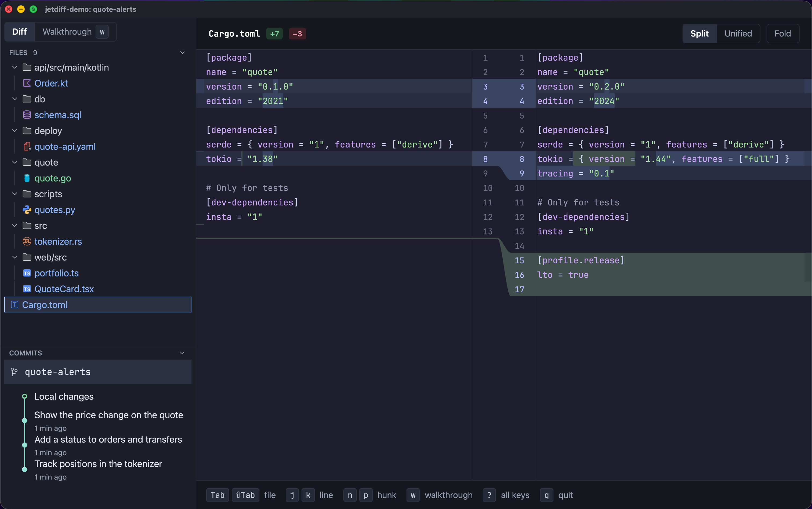
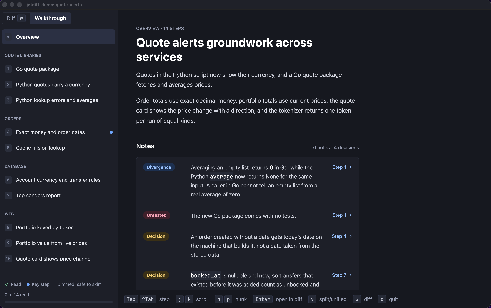
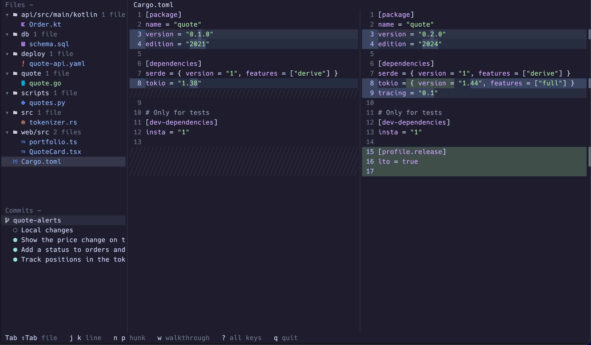

# jetdiff

A fast, read-only diff viewer for macOS, with the diff from the JetBrains IDEs. It runs in its own window, or in the terminal.

It shows a branch, Local changes, a commit, a pull request or a file pair, side by side in Split or as one code view in Unified. With `w`, Claude writes a walkthrough that explains the changes step by step.





`jetdiff --tui` shows the same diff in the terminal, with the same keys.



## Installing

Requires [rustup](https://rustup.rs). It installs the right Rust version by itself.

```
git clone git@github.com:akemkers/jetdiff.git
cd jetdiff
cargo install --locked --path crates/jetdiff
```

This puts `jetdiff` on your PATH. To update, run `git pull` and the same `cargo install` again.

On a server without a screen, install only the terminal view:

```
cargo install --locked --path crates/jetdiff --no-default-features --features tui
```

The terminal view shows file icons from [Nerd Fonts](https://www.nerdfonts.com), so the terminal needs a Nerd Font, for example Hack Nerd Font Mono. Pick the Mono variant, otherwise the icons are too wide. Without one, the icons show as empty squares. Turn them off with `icons = false` under `[terminal]` in the [settings](#settings).

## Usage

```
jetdiff [--tui] [<folder> | <commit> | <pr-link> | <left-side> <right-side>]
```

- No arguments: everything on the current branch that isn't on its base branch, committed or not, including new files. Compared with the merge base, as in a pull request. The base branch is `origin/HEAD`, else `main`, else `master`
- `<folder>`: the same, for the repo or worktree the folder is in
- `<commit>`: the commit against its parent, e.g. `HEAD~2`
- `<pr-link>`: a pull request on GitHub, e.g. `https://github.com/owner/repo/pull/12`. Run it in the repo the PR belongs to. Requires `gh`
- `<left-side> <right-side>`: two files, the old one first
- `--tui`: show the diff in the terminal instead of in a window

The side panel on the left has the changed files. For a branch, the commit list is under them: the whole branch, Local changes and each commit on the branch. Click a row to see it. `b` hides and shows the panel.

The diff updates by itself when files change on disk or you commit, rebase or switch branch. `r` reloads by hand.

Syntax colors for Kotlin, Java, TypeScript/TSX/JavaScript, Rust, Go, Python, Lua, JSON, YAML, TOML, XML, Markdown, SQL and Dockerfile.

## Walkthrough

`w` asks Claude to group the changes into steps in reading order and explain each one, with notes on decisions, divergences and what isn't tested. `w` again goes back to the diff. Only in the window, not the terminal view.

Requires [Claude Code](https://claude.com/claude-code), with `claude` on your PATH and logged in. The diff is sent to Claude, without tools or access to anything else. A large diff can take a few minutes. A finished walkthrough is saved in `~/.cache/jetdiff/walkthroughs`, so the same diff opens at once the next time.

The model, the language and the `claude` command are in the [settings](#settings).

## Settings

In `~/.config/jetdiff/config.toml`, or `$XDG_CONFIG_HOME/jetdiff/config.toml`. The file is created the first time jetdiff starts, with the defaults:

```toml
font_size = 14             # between 8 and 40, Cmd-0 goes back to this
fold_unchanged = true      # false shows the whole file
diff_mode = "split"        # or "unified", v switches while the app is running

[walkthrough]
command = ["claude"]       # with any arguments it needs first, like ["claude", "--team", "x"]
model = "opus"             # opus, sonnet or haiku. Haiku is faster and costs less
language = "English"       # the language the walkthrough is written in

[side_panel]
open = false               # true shows the file tree and the commit list at startup

[terminal]
icons = true               # file icons in the terminal view, requires a Nerd Font
smooth_scroll = true       # animated jumps like n, d and G in the terminal view
```

## Keys

A small, vim-inspired keymap for reading. The bar at the bottom shows the most important keys, and `?` shows all of them.

| Key                                 | Does                                                                                                 |
| ----------------------------------- | ---------------------------------------------------------------------------------------------------- |
| `J` `K`, Tab Shift+Tab              | Next and previous file. In the walkthrough: next and previous step                                   |
| `N` `P`                             | Next and previous row in the commit list                                                             |
| Ctrl+h Ctrl+j Ctrl+k Ctrl+l         | Move focus between the diff, the file tree and the commit list. There `j` `k` move, and Enter or `l` selects |
| `b`                                 | Hide or show the side panel                                                                          |
| `j` `k`, arrow up and down          | Move the cursor                                                                                      |
| `h` `l`, arrow left and right       | Scroll sideways                                                                                      |
| `0` `$`                             | Scroll to the start and the end of the line                                                          |
| `gg` `G`                            | First and last line                                                                                  |
| `d` `u`, Ctrl+d Ctrl+u              | Half a page down and up                                                                              |
| `n` `p`, Ctrl+n Ctrl+p, F7 Shift+F7 | Next and previous change                                                                             |
| `H` `L`                             | To the left and the right side. Split only                                                           |
| `o`                                 | Open the fold at the cursor. Clicking a fold also opens it                                           |
| `f`                                 | Open all folds, or close them all                                                                    |
| `v`                                 | Switch between Split and Unified                                                                     |
| `w`                                 | Show the walkthrough, or go back to the diff                                                         |
| Enter                               | In the walkthrough: open the change in the diff                                                      |
| `y`                                 | Copy the cursor location as `file:line`                                                              |
| `z`                                 | Roll back the change at the cursor, after Enter. Local changes only                                  |
| `r`                                 | Reload                                                                                               |
| Cmd/Ctrl+Plus, Minus, 0             | Zoom in, out and back                                                                                |
| `?`                                 | Show or hide all the keys. Esc also closes                                                           |
| `q`, Cmd/Ctrl+Q, Cmd/Ctrl+W         | Quit                                                                                                 |

## Claude Code plugin

`claude-plugin/` adds `/jetdiff` to Claude Code. It opens jetdiff for the repo the session is in, and takes the same arguments as `jetdiff`. It also works while Claude is busy. Install it at the prompt of a Claude Code session:

```
/plugin install jetdiff --marketplace akemkers/jetdiff
```

The repo is private, so this needs read access on GitHub and an SSH key or `gh auth setup-git` for github.com.

## Development

See [CONTRIBUTING.md](CONTRIBUTING.md).

The font is JetBrains Mono (SIL Open Font License). The icons are from intellij-community (Apache 2.0), intellij-rust (MIT) and Seti UI (MIT).
