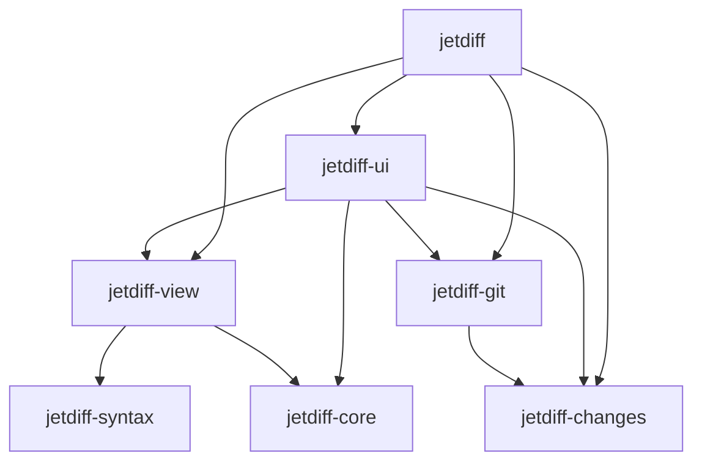

# jetdiff

En rask diff-viewer for macOS, med diffen fra JetBrains-IDE-ene. Rendres på GPU-en med [GPUI](https://www.gpui.rs).

Den viser lokale endringer, en commit eller to filer side om side, med trakt mellom sidene, ord-markering, folding av uendrede linjer og syntaksfarger. Diff-algoritmen er portert fra IntelliJ og gir samme resultat. Alt er for lesing, ingenting kan redigeres.


## Installere

```
cargo install --path crates/jetdiff
```

Det legger `jetdiff` på PATH. Krever Rust stable.

## Bruk

```
jetdiff [<mappe> | <commit> | <venstre> <høyre>] [--theme catppuccin-mocha|jetbrains-dark|jetbrains-light]
```

- Uten argumenter: lokale endringer, også nye filer git ikke kjenner. På en branch er det mot der den gikk ut fra default-branchen (`main`), så commits underveis er med. På main er det mot HEAD
- `<mappe>`: som uten argumenter, men for repoet eller worktreet mappa ligger i
- `<commit>`: commiten mot forelderen, f.eks. `HEAD~2`
- `<venstre> <høyre>`: to filer
- `--theme`: `catppuccin-mocha` er standard. `jetbrains-dark` og `jetbrains-light` er IntelliJ sine Islands-temaer

Tittelen på vinduet starter med mappenavnet til repoet, så flere vinduer kan skilles.

Til venstre er et tre over endrede filer. Nye og slettede filer vises som én side, binærfiler vises ikke. Dra i kanten for å endre bredden, dobbeltklikk for å gå tilbake.

For lokale endringer ligger commitene under treet: branchens commits, eller de siste når branchen ikke har egne (som på main). Maks 50. Klikk på en commit for å se den, og på raden øverst for å gå tilbake. Klikk på «Filer» eller «Commits» for å klappe seksjonen sammen.

Lokale endringer lastes inn på nytt når filer endres. Valgt fil beholdes, og diffen starter på toppen hvis innholdet er endret.

Uendrede linjer er foldet, med 4 linjer kontekst. Klikk på en fold for å vise mer.

Syntaksfarger for Kotlin, Java, TypeScript/TSX/JavaScript, Rust, Go, JSON, YAML, TOML, XML og Markdown. Språket velges fra filendelsen.

### Taster

Et lite, vim-inspirert keymap for lesing. Det er ingen cursor, bare en markert linje. Tastelinja nederst viser de viktigste.

| Tast                                | Gjør                                                                                            |
| ----------------------------------- | ----------------------------------------------------------------------------------------------- |
| `J` `K`, Tab Shift+Tab              | Neste og forrige fil i treet                                                                    |
| Ctrl+h Ctrl+j Ctrl+k Ctrl+l         | Bytt mellom diffen, treet og commitene. Der flytter `j` `k` og pilene, og Enter eller `l` åpner |
| `b`                                 | Skjul eller vis venstre panel                                                                   |
| `j` `k`, pil opp og ned             | Flytt markert linje. Hopper over lukkede folds                                                  |
| `h` `l`, pil venstre og høyre       | Scroll sideveis 4 tegn                                                                          |
| `0` `$`                             | Scroll til linjestart og til slutten av markert linje                                           |
| `gg` `G`                            | Første og siste linje                                                                           |
| `d` `u`, Ctrl+d Ctrl+u              | Halv side ned og opp                                                                            |
| `n` `p`, Ctrl+n Ctrl+p, F7 Shift+F7 | Neste og forrige endring                                                                        |
| `H` `L`                             | Til venstre og høyre side                                                                       |
| `o`                                 | Åpne fold ved markert linje ett nivå                                                            |
| `f`                                 | Åpne alle folds, eller lukk alle hvis ingen er lukket                                           |
| `y`                                 | Kopier `fil:linje` for markert linje. Linja er i nyeste versjon, også fra venstre side          |
| Cmd/Ctrl+Pluss, Minus, 0            | Zoom inn, ut og tilbake til 14pt. Treet følger med                                              |
| Cmd/Ctrl+Alt+C                      | Bytt kontekst: 1, 2, 4, 8 linjer eller ingen folding                                            |
| `q`, Cmd/Ctrl+Q, Cmd/Ctrl+W         | Avslutt                                                                                         |

## Utvikling

Krav:

- Rust (edition 2024, stable)
- For golden-generatoren: JDK 25 og Gradle 9.x

```
cargo run --release -p jetdiff -- examples/kotlin/a.kt examples/kotlin/b.kt
cargo test
```

`examples/` har et filpar per språk å prøve viewen på.

GPUI bygges med `runtime_shaders`, så Metal-shaderne kompileres ved oppstart og Xcode sin Metal Toolchain trengs ikke.

Koden er delt i crates med ett ansvar hver. Bare `jetdiff-ui` og binæren kjenner GPUI. All logikk for scroll, folding og geometri ligger i `jetdiff-view` og testes uten vindu.



| Crate                                           | Ansvar                                                        |
| ----------------------------------------------- | ------------------------------------------------------------- |
| [`jetdiff`](crates/jetdiff)                     | Binæren: argumenter, vindu og tastebindinger                  |
| [`jetdiff-ui`](crates/jetdiff-ui)               | GPUI-visningen                                                |
| [`jetdiff-view`](crates/jetdiff-view)           | Visningsmodell uten GUI: scroll, folding, markert linje, taster |
| [`jetdiff-core`](crates/jetdiff-core)           | Diff-algoritmen, portert fra IntelliJ                         |
| [`jetdiff-syntax`](crates/jetdiff-syntax)       | Syntaksfarger med tree-sitter                                 |
| [`jetdiff-git`](crates/jetdiff-git)             | Endringer og filinnhold fra `git`                             |
| [`jetdiff-changes`](crates/jetdiff-changes)     | Endrede filer og treet de vises i                             |

Øvrige mapper:

- `fixtures/`: testcaser for diff-algoritmen, med fasit fra IntelliJ. Se [`fixtures/README.md`](fixtures/README.md)
- `tools/golden/`: Kotlin-generatoren som lager fasiten. Se [`tools/golden/README.md`](tools/golden/README.md)
- `docs/`: overordnet løsning og research fra IntelliJ-koden

Commit-meldinger er på norsk i imperativ, f.eks. «Legg til b for å skjule venstre panel».

Fonten er JetBrains Mono (SIL Open Font License). Ikonene er fra intellij-community (Apache 2.0) og intellij-rust (MIT).
