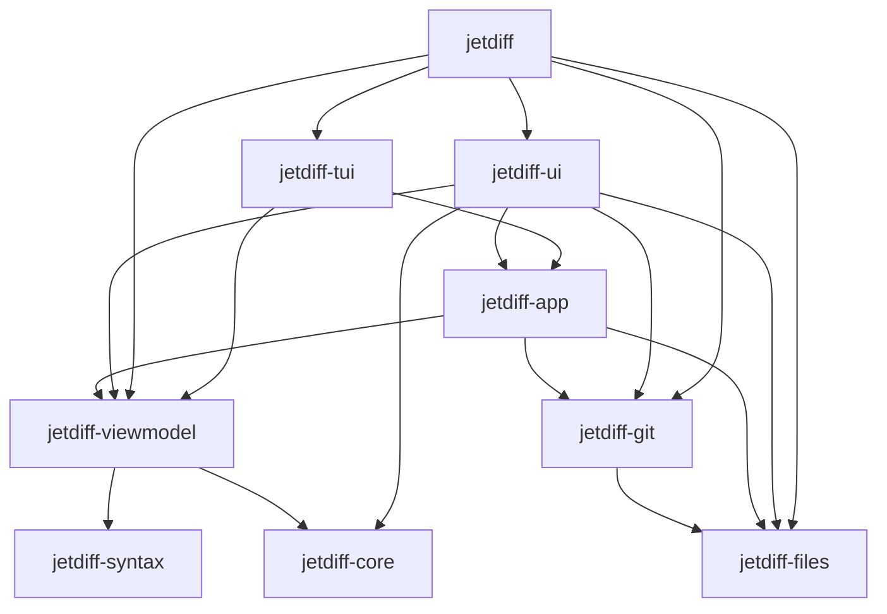

# jetdiff

A fast diff viewer for macOS, with the diff from the JetBrains IDEs. Rendered on the GPU with [GPUI](https://www.gpui.rs), or in the terminal over SSH.

It shows Local changes, a commit or a file pair in Split, with the two sides next to each other and the diff divider between them, inline highlights, folding of unchanged lines and syntax colors. `v` switches to Unified, where deleted lines sit above the added ones in a single code view. The diff algorithm is ported from IntelliJ and gives the same result. Everything is read-only; nothing can be edited.


## Installing

```
cargo install --path crates/jetdiff
```

This puts `jetdiff` on your PATH. rustup installs the Rust version pinned in `rust-toolchain.toml` by itself.

The `gui` and `tui` features are both on by default. On a server without a screen, the terminal view is enough and GPUI isn't needed:

```
cargo install --path crates/jetdiff --no-default-features --features tui
```

## Setup

The terminal view shows file icons using characters from [Nerd Fonts](https://www.nerdfonts.com), so the terminal must use a Nerd Font with file icons, for example Hack Nerd Font Mono. Pick the Mono variant, otherwise the icons are too wide. Over SSH, it's the font in the terminal on your own machine that counts.

Without such a font, the icons show as empty squares. Turn them off with `icons = false` under `[terminal]` in the [settings](#settings).

## Usage

```
jetdiff [--tui] [<folder> | <commit> | <pr-link> | <left-side> <right-side>]
```

- No arguments: everything not yet committed, including new files git doesn't know about. Always against HEAD
- `<folder>`: as without arguments, but for the repo or worktree the folder is in
- `<commit>`: the commit against its parent, e.g. `HEAD~2`
- `<pr-link>`: a pull request on GitHub, e.g. `https://github.com/owner/repo/pull/12`, as it is shown there. Must be run in the repo the PR belongs to, and fetches it from `origin`. Requires `gh`
- `<left-side> <right-side>`: a file pair, with the file on Left first
- `--tui`: shows the diff in the terminal instead of in a window. Built without `gui`, the terminal is the default

The title of the window, or the terminal, starts with the repo's folder name, so several windows can be told apart.

On the left is a file tree of changed files. Added and deleted files are always shown Unified; binary files are not shown. Drag the edge to change the width, and double-click to go back.

For Local changes, the commit list sits under the tree: the branch's commits against `origin/main`, or the latest ones when the branch has none of its own. At most 50. Click a commit to see it, and the top row to go back. Click «Files» or «Commits» to open or close the section.

Local changes are read again automatically when files change on disk. The selected file is kept, and the diff starts at the top if the content has changed.

Unchanged lines are folded, with 4 lines of context. Click a fold to open it. Unified has no folding.

Syntax colors for Kotlin, Java, TypeScript/TSX/JavaScript, Rust, Go, JSON, YAML, TOML, XML and Markdown. The language is picked from the file extension.

### Settings

Read from `$XDG_CONFIG_HOME/jetdiff/config.toml`, or `~/.config/jetdiff/config.toml`. The file is created the first time jetdiff starts, with the defaults:

```toml
theme = "catppuccin-mocha"
font_size = 14             # between 8 and 40, Cmd-0 goes back to this
fold_unchanged = true      # false shows the whole file
diff_mode = "split"        # or "unified", v switches while the app is running

[side_panel]
open = false               # true shows the file tree and the commit list at startup

[terminal]
icons = true               # file icons in the terminal view, requires a Nerd Font
```

`theme` is `catppuccin-mocha`, `jetbrains-dark` or `jetbrains-light`. The last two are IntelliJ's Islands themes.

### Keys

A small, vim-inspired keymap for reading. The cursor is a whole line, with no column. The keymap bar at the bottom shows the most important keys, and `?` shows all of them.

| Key                                 | Does                                                                                                 |
| ----------------------------------- | ---------------------------------------------------------------------------------------------------- |
| `J` `K`, Tab Shift+Tab              | Next and previous file in the tree                                                                   |
| Ctrl+h Ctrl+j Ctrl+k Ctrl+l         | Move focus between the diff, the tree and the commit list. There `j` `k` and the arrows move, and Enter or `l` selects |
| `b`                                 | Hide or show the side panel                                                                          |
| `j` `k`, arrow up and down          | Move the cursor. Skips closed folds                                                                  |
| `h` `l`, arrow left and right       | Scroll sideways 4 characters                                                                         |
| `0` `$`                             | Scroll to the start of the line and to the end of the cursor's line                                  |
| `gg` `G`                            | First and last line                                                                                  |
| `d` `u`, Ctrl+d Ctrl+u              | Half a page down and up                                                                              |
| `n` `p`, Ctrl+n Ctrl+p, F7 Shift+F7 | Next and previous hunk                                                                               |
| `H` `L`                             | To Left and Right. Split only                                                                        |
| `o`                                 | Open the fold at the cursor. Split only                                                              |
| `f`                                 | Open all folds, or close all if none are closed. Split only                                          |
| `v`                                 | Switch between Split and Unified for all files. The cursor stays where it is                         |
| `y`                                 | Copy the cursor location (`file:line`). The line is in the newest version, also from Left            |
| `r`                                 | Roll back the hunk at the cursor to Left, after Enter. Local changes only                            |
| Cmd/Ctrl+Plus, Minus, 0             | Zoom in, out and back to 14pt. The tree follows                                                      |
| `?`                                 | Show or hide all the keys. Esc also closes                                                           |
| `q`, Cmd/Ctrl+Q, Cmd/Ctrl+W         | Quit                                                                                                 |

## Development

Requirements:

- Rust: the version in `rust-toolchain.toml`, which rustup installs by itself (edition 2024)
- For the golden generator: JDK 25 and Gradle 9.x

```
cargo run --release -p jetdiff -- examples/kotlin/a.kt examples/kotlin/b.kt
cargo test
```

`examples/` has a file pair per language to try the viewer on.

GPUI is built with `runtime_shaders`, so the Metal shaders are compiled at startup and Xcode's Metal Toolchain isn't needed.

How the code is organized is in [CODING_STANDARDS.md](CODING_STANDARDS.md). The domain language is in [GLOSSARY.md](GLOSSARY.md).

The code is split into crates with one responsibility each. Only `jetdiff-ui` and the binary know GPUI, and only `jetdiff-tui` knows the terminal. All the logic for scroll, folding and geometry is in `jetdiff-viewmodel`, and the state around the diff (the repo source, tree and commits) is in `jetdiff-app`. Both are tested without a window.



| Crate                                           | Responsibility                                                    |
| ----------------------------------------------- | ----------------------------------------------------------------- |
| [`jetdiff`](crates/jetdiff)                     | The binary: arguments, config and window                          |
| [`jetdiff-ui`](crates/jetdiff-ui)               | The GPUI view                                                     |
| [`jetdiff-tui`](crates/jetdiff-tui)             | The terminal view                                                 |
| [`jetdiff-app`](crates/jetdiff-app)             | The state around the diff, without a GUI: repo source, tree, commits |
| [`jetdiff-viewmodel`](crates/jetdiff-viewmodel) | View model without a GUI: scroll, folding, cursor, keys           |
| [`jetdiff-core`](crates/jetdiff-core)           | The diff algorithm, ported from IntelliJ                          |
| [`jetdiff-syntax`](crates/jetdiff-syntax)       | Syntax colors with tree-sitter                                    |
| [`jetdiff-git`](crates/jetdiff-git)             | Changed files, file content and commits from `git`                |
| [`jetdiff-files`](crates/jetdiff-files)         | Changed files and the tree they are shown in                      |

Other folders:

- `fixtures/`: test cases for the diff algorithm, with expected results from IntelliJ. See [`fixtures/README.md`](fixtures/README.md)
- `tools/golden/`: the Kotlin generator that produces the expected results. See [`tools/golden/README.md`](tools/golden/README.md)
- `docs/`: the solution overview and research on the IntelliJ code

Commit messages are in English, in the imperative, e.g. "Add b to hide the side panel".

The font is JetBrains Mono (SIL Open Font License). The icons are from intellij-community (Apache 2.0), intellij-rust (MIT) and Seti UI (MIT).
