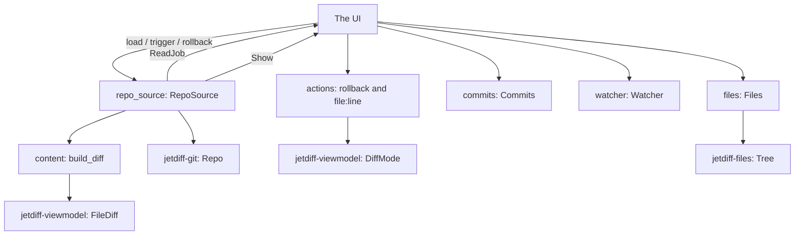

# jetdiff-app

The state around the diff: the changed files in the repo, the file being shown, the file tree, the commit list and the watcher. No GUI, so the GPUI view and a terminal view can share it.

## Why

`jetdiff-viewmodel` knows everything about the diff of one file, but nothing about where the file comes from. What happens around it, like the selected file being kept after an autoreload, or a commit that doesn't exist giving a warning and Local changes again, used to live in `jetdiff-ui` together with GPUI. A new UI would then have had to write it again and keep it the same by hand. Here it lives once, with tests.

## What the crate owns

| Owns                                                                                                    | Module    |
| ------------------------------------------------------------------------------------------------------- | --------- |
| The repo source: the commit being shown, the changed files and the file being shown. Reading it again on each trigger, and which file is selected afterwards | `repo_source` |
| From the content git gives to `FileDiff`: binary file, too big, identical content and syntax          | `content` |
| The file tree's rows and cursor, and folders being open or closed                                       | `files`   |
| The commit list's rows, cursor and selection, and the age like "3 hours ago"                          | `commits` |
| Rollback and `file:line` for the cursor's line: what is rolled back, or why it can't be               | `actions` |
| The keys in the keymap bar and in the help on `?`                                                     | `help`    |
| The keys outside the diff: switching files, moving focus, the side panel, help, zoom and quit         | `keys`    |
| Paths changed in Local changes, collected until it is quiet                                            | `watcher` |
| A notification and its level (`Notification`, `NotificationLevel`)                                    | `notification` |
| One pinned and one brief notification, and which one shows now (`NotificationSlot`)                  | `notification_slot` |

## What the crate doesn't own

| Lives in                            | What                                                                       |
| ----------------------------------- | -------------------------------------------------------------------------- |
| `jetdiff-viewmodel`                 | The diff of one file: cursor, scroll, folding, Split and Unified, vim keys |
| `jetdiff-git`                       | Talking to `git`                                                           |
| `jetdiff-files`                     | `ChangedFile` and the tree model                                           |
| The UI (`jetdiff-ui`, `jetdiff-tui`) | Drawing, focus, mouse, animation, zoom, clipboard, timers and threads      |
| The binary (`jetdiff`)              | Arguments and the config file                                              |

The boundary is that this crate decides **what** is shown, and the UI decides **how**. An `if` that changes what is shown belongs here.

The crate starts no threads and has no timers. Work that takes time comes as a job the UI runs where it suits, and the answer is handed back. The selected file is owned by the UI, since both the tree and the diff must see it. Here we only compute what it becomes.

## Usage

```rust
use jetdiff_app::{Applied, RepoSource, Show, Watcher};

let mut repo_source = RepoSource::new(repo, changed_files);
let mut selected = repo_source.first();

// The selected file
match repo_source.load(selected) {
    Show::Diff(shown) => { /* show shown.diff, pin shown.pinned */ }
    Show::Empty { pinned } => { /* empty diff, pin `pinned` */ }
    Show::Unchanged => {}
}

// The watcher is asked every `watcher::POLL`
let watcher = Watcher::new(repo_source.repo().root())?;
if let Some(paths) = watcher.take() {
    // Also `select_commit` and `rolled_back`, each with its own trigger
    let job = repo_source.files_changed(paths);   // Send, can run on another thread
    let read = job.run();
    match repo_source.apply(read) {
        Applied::Done { commits, changed_files, file, brief } => selected = file,
        Applied::Failed { shown, brief } => { /* the commit list shows `shown` */ }
    }
}
```



## Tests

```
cargo test -p jetdiff-app
```

The tests for `repo_source` create a temporary git repo and require `git` on the PATH.
