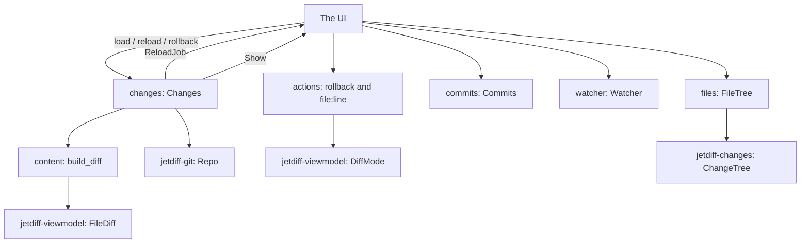

# jetdiff-app

The state around the diff: the changes in the repo, the file being shown, the file tree, the commit list and the watcher. No GUI, so the GPUI view and a terminal view can share it.

## Why

`jetdiff-viewmodel` knows everything about the diff of one file, but nothing about where the file comes from. What happens around it, like the selected file being kept after a reload, or a commit that doesn't exist giving a warning and Local changes again, used to live in `jetdiff-ui` together with GPUI. A new UI would then have had to write it again and keep it the same by hand. Here it lives once, with tests.

## What the crate owns

| Owns                                                                                                    | Module    |
| ------------------------------------------------------------------------------------------------------- | --------- |
| The repo, the commit being shown, the changes and the file being shown. Reload, and which file is selected afterwards | `changes` |
| From the content git gives to `FileDiff`: binary file, too big, identical content and syntax          | `content` |
| The file tree's rows and cursor, and folders being collapsed                                          | `files`   |
| The commit list's rows, cursor and selection, and the age like "3 hours ago"                          | `commits` |
| Rollback and `file:line` for the cursor's line: what is rolled back, or why it can't be               | `actions` |
| The keys in the keymap bar and in the help on `?`                                                     | `help`    |
| The keys outside the diff: switching files, panels, help, zoom and quit                               | `keys`    |
| Paths changed in Local changes, collected until it is quiet                                            | `watcher` |
| The messages and their level (`Notice`, `Level`)                                                       | `content` |

## What the crate doesn't own

| Lives in                            | What                                                                       |
| ----------------------------------- | -------------------------------------------------------------------------- |
| `jetdiff-viewmodel`                 | The diff of one file: cursor, scroll, folding, Split and Unified, vim keys |
| `jetdiff-git`                       | Talking to `git`                                                           |
| `jetdiff-changes`                   | `FileChange` and the tree model                                            |
| The UI (`jetdiff-ui`, `jetdiff-tui`) | Drawing, focus, mouse, animation, zoom, clipboard, timers and threads      |
| The binary (`jetdiff`)              | Arguments and the config file                                              |

The boundary is that this crate decides **what** is shown, and the UI decides **how**. An `if` that changes what is shown belongs here.

The crate starts no threads and has no timers. Work that takes time comes as a job the UI runs where it suits, and the answer is handed back. The selected file is owned by the UI, since both the tree and the diff must see it. Here we only compute what it becomes.

## Usage

```rust
use jetdiff_app::{Changes, Reloaded, Show, Watcher};

let mut changes = Changes::new(repo, repo_changes);
let mut selected = changes.first();

// The selected file
match changes.load(selected) {
    Show::Diff(shown) => { /* show shown.diff, pin shown.notice */ }
    Show::Empty(notice) => { /* empty diff and the message */ }
    Show::Unchanged => {}
}

// The watcher is asked every `watcher::POLL`
let watcher = Watcher::new(changes.repo().root())?;
if let Some(paths) = watcher.take() {
    let job = changes.reload();          // Send, can run on another thread
    let loaded = job.run();
    match changes.reloaded(loaded, &paths) {
        Reloaded::Done { commits, changes, file, notice } => selected = file,
        Reloaded::Failed { shown, error } => { /* the commit list shows `shown` */ }
    }
}
```



## Tests

```
cargo test -p jetdiff-app
```

The tests for `changes` create a temporary git repo and require `git` on the PATH.
