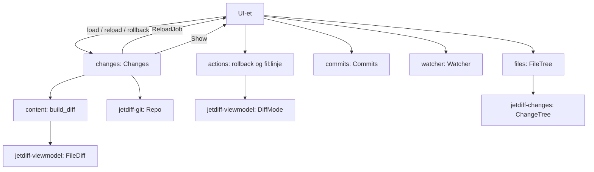

# jetdiff-app

Tilstanden rundt diffen: endringene i repoet, fila som vises, filtreet, commit-lista og watcheren. Uten GUI, så GPUI-visningen og en terminalvisning kan dele den.

## Hvorfor

`jetdiff-viewmodel` vet alt om diffen av én fil, men ingenting om hvor fila kommer fra. Det som skjer rundt, som at valgt fil beholdes etter en reload eller at en commit som ikke finnes gir advarsel og working tree igjen, lå før i `jetdiff-ui` sammen med GPUI. Et nytt UI måtte da skrevet det på nytt og holdt det likt for hånd. Her ligger det én gang, med tester.

## Hva craten eier

| Eier                                                                                                | Modul     |
| --------------------------------------------------------------------------------------------------- | --------- |
| Repoet, commiten som vises, endringene og fila som vises. Reload, og hvilken fil som velges etterpå | `changes` |
| Fra innholdet git gir til `FileDiff`: binærfil, for stor, likt innhold og syntaks                   | `content` |
| Filtreets rader og markør, og mapper som klappes sammen                                             | `files`   |
| Commit-listas rader, markør og valg, og alderen som «3 timer siden»                                 | `commits` |
| Rollback og `fil:linje` for markert linje: hva som rulles tilbake, eller hvorfor det ikke går        | `actions` |
| Tastene i tastelinja og i hjelpen på `?`                                                            | `help`    |
| Tastene utenfor diffen: filbytte, paneler, hjelp, zoom og avslutt                                   | `keys`    |
| Stier som er endret i working tree, samlet til det er stille                                        | `watcher` |
| Beskjedene og nivået deres (`Notice`, `Level`)                                                      | `content` |

## Hva craten ikke eier

| Ligger i             | Hva                                                                             |
| -------------------- | ------------------------------------------------------------------------------- |
| `jetdiff-viewmodel`       | Diffen av én fil: markert linje, scroll, folding, split og unified, vim-tastene |
| `jetdiff-git`        | Å snakke med `git`                                                              |
| `jetdiff-changes`    | `FileChange` og tremodellen                                                     |
| UI-et (`jetdiff-ui`) | Tegning, fokus, mus, animasjon, zoom, utklippstavla, timere og tråder           |
| Binæren (`jetdiff`)  | Argumenter og config-fila                                                       |

Grensen er at denne craten bestemmer **hva** som vises, og UI-et bestemmer **hvordan**. En `if` som endrer hva som vises hører hjemme her.

Craten starter ingen tråder og har ingen timere. Arbeid som tar tid kommer som en jobb UI-et kjører der det passer, og svaret gis tilbake. Valgt fil eies av UI-et, siden både treet og diffen må se den. Her regnes bare ut hva den blir.

## Bruk

```rust
use jetdiff_app::{Changes, Reloaded, Show, Watcher};

let mut changes = Changes::new(repo, repo_changes);
let mut selected = changes.first();

// Fila som er valgt
match changes.load(selected) {
    Show::Diff(shown) => { /* vis shown.diff, fest shown.notice */ }
    Show::Empty(notice) => { /* tom diff og beskjeden */ }
    Show::Unchanged => {}
}

// Watcheren spørres hver `watcher::POLL`
let watcher = Watcher::new(changes.repo().root())?;
if let Some(paths) = watcher.take() {
    let job = changes.reload();          // Send, kan kjøres på en annen tråd
    let loaded = job.run();
    match changes.reloaded(loaded, &paths) {
        Reloaded::Done { commits, changes, file, notice } => selected = file,
        Reloaded::Failed { shown, error } => { /* commit-lista viser `shown` */ }
    }
}
```



## Tester

```
cargo test -p jetdiff-app
```

Testene for `changes` lager et midlertidig git-repo og krever `git` på PATH.
