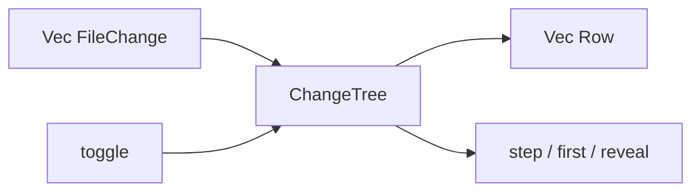

# jetdiff-changes

Changed files and the tree they are shown in.

## Why

The tree should behave as in IntelliJ's commit dialog: folders first, folders with only one subfolder merged, and folders that can be collapsed. That logic is split out here so it can be tested without git and without a GUI.

## Usage

```rust
use jetdiff_changes::{ChangeTree, FileChange, Status};

let changes = vec![FileChange { path: "src/main.rs".into(), old_path: None, status: Status::Modified }];
let mut tree = ChangeTree::new(&changes);
let rows = tree.rows();                 // what to draw, in order
let first = tree.first();               // the first file
let next = tree.step(first.unwrap(), true);
tree.toggle("src");                     // collapse or expand the folder
```

Files are referred to by index in `changes`. `touched` counts how many files changed between two lists, and is used for the message after a reload.


