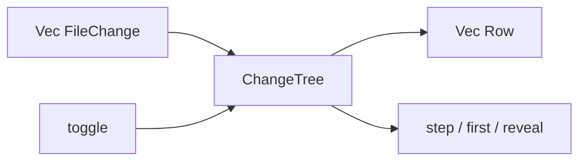

# jetdiff-changes

Endrede filer og treet de vises i.

## Hvorfor

Treet skal oppføre seg som i commit-dialogen i IntelliJ: mapper først, mapper med bare én undermappe slått sammen, og mapper som kan klappes sammen. Den logikken er skilt ut hit så den kan testes uten git og uten GUI.

## Bruk

```rust
use jetdiff_changes::{ChangeTree, FileChange, Status};

let changes = vec![FileChange { path: "src/main.rs".into(), old_path: None, status: Status::Modified }];
let mut tree = ChangeTree::new(&changes);
let rows = tree.rows();                 // det som skal tegnes, i rekkefølge
let first = tree.first();               // første fil
let next = tree.step(first.unwrap(), true);
tree.toggle("src");                     // klapp mappa sammen eller opp
```

Filer refereres med indeks i `changes`. `touched` teller hvor mange filer som er endret mellom to lister, og brukes til beskjeden etter en reload.


