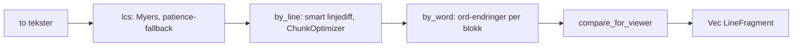

# jetdiff-core

Diff-algoritmen fra IntelliJ, portert til Rust.

## Hvorfor

Målet er at diffen blir lik den i JetBrains-IDE-ene. Da holder det ikke med en vanlig Myers-diff. IntelliJ har heuristikker oppå, som å matche linjer uten whitespace først, flytte endringer til naturlige grenser og finne ord-endringer inni linjene. Porten gir samme resultat, og golden-testene sjekker det mot IntelliJ sin egen kode.

Craten har ingen avhengigheter og vet ingenting om filer, git eller GUI.

## Bruk

```rust
use jetdiff_core::{ComparisonPolicy, compare_for_viewer};

let fragments = compare_for_viewer(left, right, ComparisonPolicy::Default)?;
for f in &fragments {
    // f.lines1 og f.lines2: endrede linjer på hver side
    // f.inner: ord-endringer inni blokken, None er hele linjer
}
```

- `compare_lines`: bare linjer
- `compare_lines_inner`: linjer med ord-endringer
- `compare_for_viewer`: som over, pluss etterbehandlingen viewen i IntelliJ gjør

Offsets er UTF-8 bytes. `DiffTooBig` betyr at filene er for store til å diffes innen terskelen IntelliJ bruker.



## Tester

```
cargo test -p jetdiff-core
```

`tests/golden.rs` kjører alle casene i `fixtures/` og sammenligner med `expected.json`, som er laget av IntelliJ. Mot et annet sett med fixturer:

```
JETDIFF_FIXTURES=/sti/til/fixturer cargo test --test golden
```

Ny case: lag `fixtures/<navn>/a.txt` og `b.txt`, kjør `tools/golden/gen.sh` og så `cargo test`. Se [`fixtures/README.md`](../../fixtures/README.md) og [`tools/golden/README.md`](../../tools/golden/README.md).

Research om algoritmen ligger i [`docs/research/01-diff-algoritme.md`](../../docs/research/01-diff-algoritme.md).
