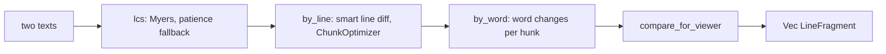

# jetdiff-core

The diff algorithm from IntelliJ, ported to Rust.

## Why

The goal is a diff identical to the one in the JetBrains IDEs. A plain Myers diff isn't enough for that. IntelliJ has heuristics on top, like matching lines without whitespace first, moving changes to natural boundaries and finding word changes inside lines. The port gives the same result, and the golden tests check it against IntelliJ's own code.

The crate has no dependencies and knows nothing about files, git or a GUI.

## Usage

```rust
use jetdiff_core::{ComparisonPolicy, compare_for_viewer};

let fragments = compare_for_viewer(left, right, ComparisonPolicy::Default)?;
for f in &fragments {
    // f.lines1 and f.lines2: changed lines on each side
    // f.inner: word changes inside the hunk, None is whole lines
}
```

- `compare_lines`: lines only
- `compare_lines_inner`: lines with word changes
- `compare_for_viewer`: as above, plus the post-processing the viewer in IntelliJ does

Offsets are UTF-8 bytes. `DiffTooBig` means the files are too big to diff within the threshold IntelliJ uses.



## Tests

```
cargo test -p jetdiff-core
```

`tests/golden.rs` runs all the cases in `fixtures/` and compares with `expected.json`, which is produced by IntelliJ. Against another set of fixtures:

```
JETDIFF_FIXTURES=/path/to/fixtures cargo test --test golden
```

New case: create `fixtures/<name>/a.txt` and `b.txt`, run `tools/golden/gen.sh` and then `cargo test`. See [`fixtures/README.md`](../../fixtures/README.md) and [`tools/golden/README.md`](../../tools/golden/README.md).

Research on the algorithm is in [`docs/research/01-diff-algorithm.md`](../../docs/research/01-diff-algorithm.md).
