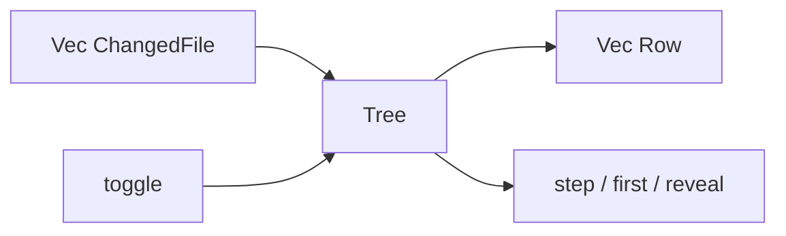

# jetdiff-files

Changed files and the tree they are shown in.

## Why

The tree should behave as in IntelliJ's commit dialog: folders first, folders with only one subfolder merged, and folders that can be opened and closed. That logic is split out here so it can be tested without git and without a GUI.

## Usage

```rust
use jetdiff_files::{ChangedFile, FileStatus, Tree};

let files = vec![ChangedFile { path: "src/main.rs".into(), renamed_from: None, status: FileStatus::Modified }];
let mut tree = Tree::new(&files);
let rows = tree.rows();                 // what to draw, in order
let first = tree.first();               // the first file
let next = tree.step(first.unwrap(), true);
tree.toggle("src");                     // open or close the folder
```

Files are referred to by index in the list of changed files. `touched` counts how many files changed between two lists, and is used for the message after a reload.


