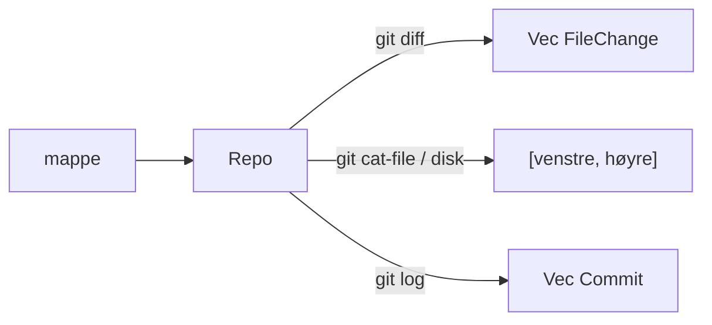

# jetdiff-git

Endringer og filinnhold fra git.

## Hvorfor

Resultatet skal være det samme som `git diff` gir. Derfor kaller craten `git` i stedet for å bruke et bibliotek. Da følger brukerens config og rename-deteksjon med.

Craten bestemmer også hva som sammenlignes. Working tree er mot HEAD. Commit-lista har commitene siden merge-base med default-branchen, eller de siste når branchen ikke har egne.

## Bruk

```rust
use jetdiff_git::Repo;

let repo = Repo::work_tree(Path::new("."))?;   // eller Repo::commit(dir, "HEAD~2")
let changes = repo.changes()?;                  // Vec<FileChange>
let [left, right] = repo.read(&changes[0])?;    // innholdet på hver side
let commits = repo.commits()?;                  // branchens commits, maks 50
```

`name()` er mappenavnet til repoet.



Feil kommer som `String`, klare til å vises.
