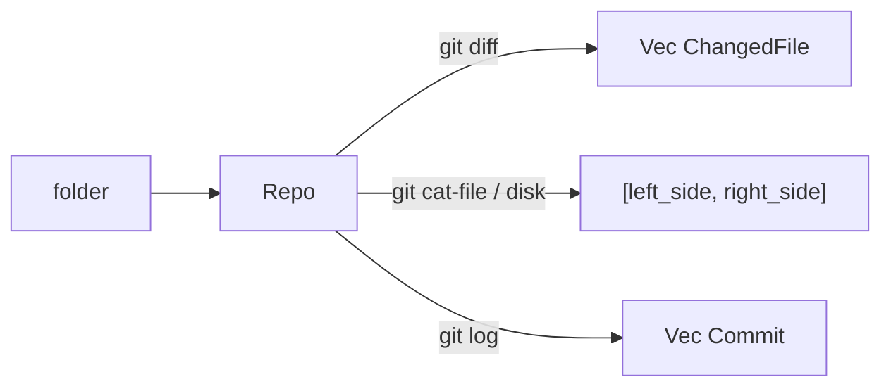

# jetdiff-git

Changed files, file content and commits from git.

## Why

The result should be the same as what `git diff` gives. That's why the crate calls `git` instead of using a library. Then the user's config and rename detection come along.

The crate also decides what is compared. Branch is against the merge base with the base branch (`origin/HEAD`, else `main`, else `master`), and Local changes against HEAD. Both read Right from disk. The commit list has the branch's own commits, the ones since the merge base. On the base branch without any, it has the newest commits on HEAD, and `History::own` tells the two apart.

It also knows where HEAD and the branches are kept, also in a worktree, so the watcher can tell when HEAD moves.

## Usage

```rust
use jetdiff_git::Repo;

let repo = Repo::branch(Path::new("."))?;            // or Repo::local_changes(dir), Repo::commit(dir, "HEAD~2")
let files = repo.changed_files()?;                   // Vec<ChangedFile>
let [left_side, right_side] = repo.read(&files[0])?; // the content on each side
let commits = repo.commits()?;                       // the branch's own commits, or on main the newest, at most 50
let label = repo.branch_name();                      // None when HEAD is detached
let git_dirs = repo.git_dirs()?;                     // which paths mean that HEAD moved
```

`name()` is the folder name of the repo. Only Local changes can roll back (`can_rollback()`).



Errors come as a `String`, ready to be shown.
