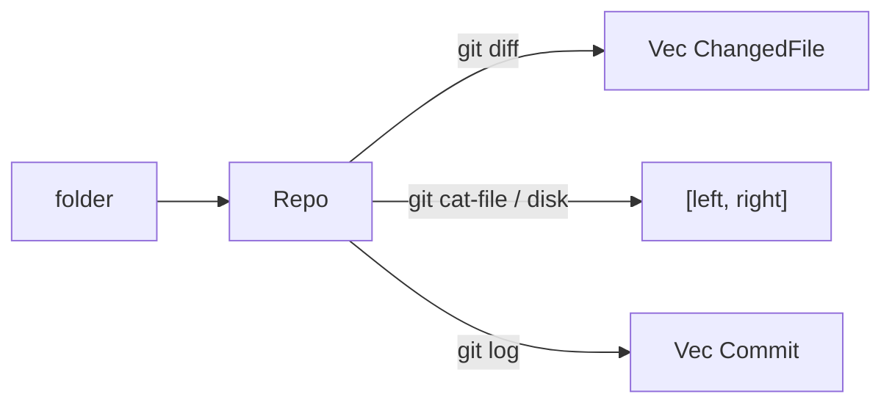

# jetdiff-git

Changes and file content from git.

## Why

The result should be the same as what `git diff` gives. That's why the crate calls `git` instead of using a library. Then the user's config and rename detection come along.

The crate also decides what is compared. Local changes are against HEAD. The commit list has the commits since the merge base with the default branch, or the latest ones when the branch has none of its own.

## Usage

```rust
use jetdiff_git::Repo;

let repo = Repo::local_changes(Path::new("."))?;   // or Repo::commit(dir, "HEAD~2")
let files = repo.changed_files()?;              // Vec<ChangedFile>
let [left, right] = repo.read(&files[0])?;      // the content on each side
let commits = repo.commits()?;                  // the branch's commits, at most 50
```

`name()` is the folder name of the repo.



Errors come as a `String`, ready to be shown.
