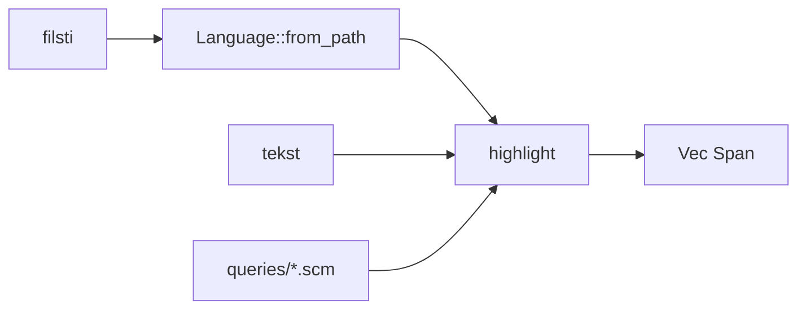

# jetdiff-syntax

Syntaksfarger med tree-sitter.

## Hvorfor

Fargene skal ligne IntelliJ. Tokenene tilsvarer derfor IntelliJ sine `DEFAULT_*`-nøkler (`Keyword`, `String`, `Function` osv.), og temaet i `jetdiff-view` gir dem farge.

Hele filen highlightes, ikke bare synlige linjer. Da får også slettede linjer og linjer inni en fold riktig syntaks.

## Bruk

```rust
use jetdiff_syntax::{Language, highlight};

if let Some(lang) = Language::from_path("src/main.rs") {
    let spans = highlight(lang, text);
    // hver Span har et byte-intervall og en Token
}
```

Språk: Kotlin, Java, TypeScript, TSX, JavaScript, Rust, Go, JSON, YAML, TOML, XML og Markdown.

Queries ligger i `queries/`, én per språk. De er skrevet for jetdiff, ikke hentet fra grammatikkene, så de treffer IntelliJ sine kategorier.



To ting å vite når du endrer queries:

- Treffer flere mønstre samme node, vinner det siste
- Markdown-injeksjon trenger `injection.include-children`

Eksempler per språk ligger i `examples/` i roten.
