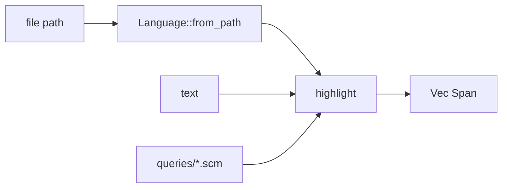

# jetdiff-syntax

Syntax colors with tree-sitter.

## Why

The colors should look like IntelliJ. The tokens therefore correspond to IntelliJ's `DEFAULT_*` keys (`Keyword`, `String`, `Function` etc.), and the theme in `jetdiff-viewmodel` gives them a color.

Rust has its own keys in the Rust plugin (`org.rust.STRUCT`, `ENUM_VARIANT` etc.), and many of them have a color where `DEFAULT_*` is plain text. They have their own tokens. Without type info they are guessed from the name: a capital first letter is a struct, and only the enums from the prelude become enums.

The whole file is highlighted, not just the visible lines. That way deleted lines and lines inside a fold also get the right syntax.

## Usage

```rust
use jetdiff_syntax::{Language, highlight};

if let Some(lang) = Language::from_path("src/main.rs") {
    let spans = highlight(lang, text);
    // each Span has a byte range and a Token
}
```

Languages: Kotlin, Java, TypeScript, TSX, JavaScript, Rust, Go, Python, JSON, YAML, TOML, XML and Markdown.

The queries are in `queries/`, one per language. They are written for jetdiff, not taken from the grammars, so they hit IntelliJ's categories.



Two things to know when changing queries:

- If several patterns match the same node, the last one wins
- Markdown injection needs `injection.include-children`

Examples per language are in `examples/` at the root.
