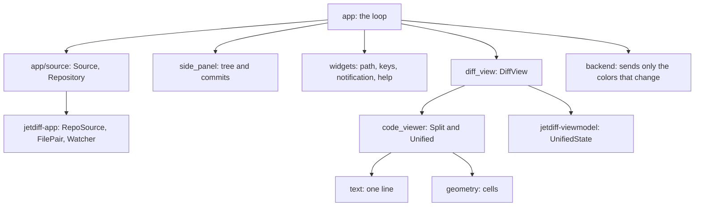

# jetdiff-tui

The terminal view: the diff, the file tree and the commit list, for SSH and machines without a screen.

## Why

The same diff as the GPUI view, where there is no GPU. The logic is in `jetdiff-viewmodel` and `jetdiff-app`, so all that's here is drawing in cells and input from the terminal. The viewport has a line height of 1, so scroll and scrolloff are counted in rows.

In GPUI, each side has its own scroll, and the diff divider between them shows which lines belong together. The diff divider is drawn with curves, which a terminal can't do. Here the Left and Right lines sit on the same row instead. If a hunk is shorter on one side, it is filled in with hatched rows, so the rest of the file stays aligned. Lines with text in common are put on the same row.

The rows are made by `UnifiedDiff::with_layout` with `RowLayout::Split`, so Split and Unified use the same `UnifiedState` for cursor and scroll.

## Usage

```rust
use jetdiff_tui::{Settings, run_file_pair, run_repo_source};

let settings = Settings { theme, unified: false, side_panel_open: false, icons: true };
run_file_pair(file_pair, diff, &title, settings)?;       // a file pair
run_repo_source(repo, changed_files, &title, settings)?; // a repo source
```

Differences from the GPUI view:

- Split is aligned rows, without the diff divider and sync scroll
- Split folds too, since both diff modes are rows. A closed fold is a row of `~`
- One side at a time, so `H` and `L` do nothing
- No zoom and no scroll animation
- `y` copies with OSC 52, which works over SSH when the terminal supports it
- The colors are truecolor
- The file icons are Nerd Font characters in `icons.rs`, and `icons` turns them off



## Tests

```
cargo test -p jetdiff-tui
```
