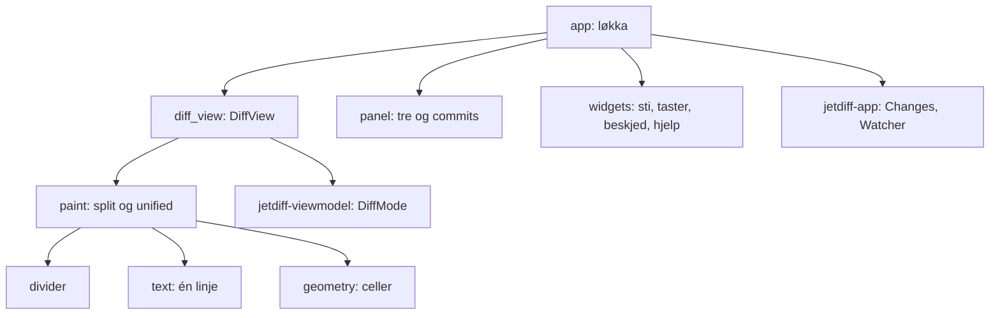

# jetdiff-tui

Terminalvisningen: diffen, filtreet og commit-lista, for SSH og maskiner uten skjerm.

## Hvorfor

Samme diff som GPUI-visningen, der GPU-en ikke finnes. Logikken ligger i `jetdiff-viewmodel` og `jetdiff-app`, så her er bare tegning i celler og input fra terminalen. Viewporten har linjehøyde 1, så scroll og scrolloff regnes i rader.

## Bruk

```rust
use jetdiff_tui::{Settings, run_changes, run_file};

let settings = Settings { theme, collapse_unchanged: true, unified: false, side_panel_open: false };
run_file(diff, paths, settings)?;          // to filer
run_changes(repo, changes, settings)?;     // et repo eller en commit
```

Forskjeller fra GPUI-visningen:

- Trakten er 4 kolonner med halvblokker, og en endring uten linjer på én side er en understreking
- Ingen zoom og ingen scroll-animasjon
- `y` kopierer med OSC 52, som virker over SSH når terminalen støtter det
- Fargene er truecolor



## Tester

```
cargo test -p jetdiff-tui
```
