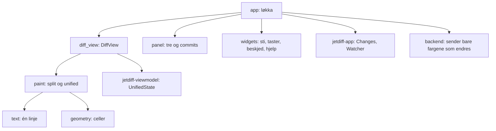

# jetdiff-tui

Terminalvisningen: diffen, filtreet og commit-lista, for SSH og maskiner uten skjerm.

## Hvorfor

Samme diff som GPUI-visningen, der GPU-en ikke finnes. Logikken ligger i `jetdiff-viewmodel` og `jetdiff-app`, så her er bare tegning i celler og input fra terminalen. Viewporten har linjehøyde 1, så scroll og scrolloff regnes i rader.

I GPUI har sidene hver sin scroll, og trakten mellom dem viser hvilke linjer som hører sammen. Trakten tegnes med kurver, og det går ikke i en terminal. Her står venstre og høyre linje på samme rad i stedet. Er en endring kortere på den ene siden, fylles den ut med skraverte rader, så resten av fila står likt. Linjer med tekst felles settes på samme rad.

Radene lages av `UnifiedDiff::with_layout` med `RowLayout::Split`, så split og unified bruker samme `UnifiedState` for cursor og scroll.

## Bruk

```rust
use jetdiff_tui::{Settings, run_changes, run_file};

let settings = Settings { theme, unified: false, side_panel_open: false, icons: true };
run_file(diff, paths, &title, settings)?;          // to filer
run_changes(repo, changes, &title, settings)?;     // et repo eller en commit
```

Forskjeller fra GPUI-visningen:

- Split er justerte rader, uten trakt og sync scroll
- Ingen folding, så `o`, `f`, `H` og `L` gjør ingenting, og `collapse_unchanged` brukes ikke
- Ingen zoom og ingen scroll-animasjon
- `y` kopierer med OSC 52, som virker over SSH når terminalen støtter det
- Fargene er truecolor
- Filikonene er Nerd Font-tegn i `icons.rs`, og `icons` skrur dem av



## Tester

```
cargo test -p jetdiff-tui
```
