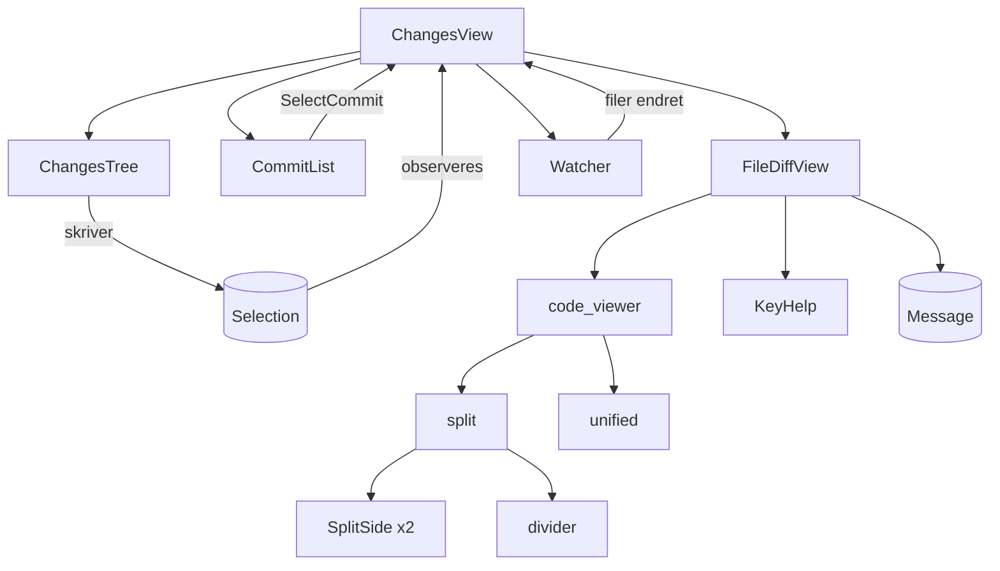

# jetdiff-ui

GPUI-visningen: diffen, filtreet og commit-lista.

## Hvorfor

Dette er laget som tegner. Logikken for diffen ligger i `jetdiff-viewmodel`, og tilstanden rundt den (endringer, reload, tre, commits, watcher) i `jetdiff-app`. Her er bare det som trenger GPUI: tekst og former, mus og taster, animasjon, zoom, fokus, og å kjøre jobbene fra `jetdiff-app` i bakgrunnen.

Modulene kjenner ikke hverandre. Delt tilstand, som valgt fil, ligger i små GPUI-entiteter som alle observerer. Treet skriver til `Selection` ved klikk, og diffen følger den. `J` og `K` i diffen sender et event som treet flytter valget for.

## Bruk

To visninger er offentlige:

```rust
use jetdiff_ui::{Assets, ChangesView, FileDiffView, Settings, UiTheme, load_font};

Application::new().with_assets(Assets).run(|cx| {
    load_font(cx);
    cx.set_global(Settings {
        theme: UiTheme::mocha(),
        font_size: 14.,
        collapse_unchanged: true,
        unified: false,
        side_panel_open: false,
    });
    // Én fil:
    cx.new(|cx| FileDiffView::standalone(diff, paths, cx));
    // Et repo eller en commit, med tre og commits:
    cx.new(|cx| ChangesView::new(repo, changes, cx));
});
```

`Settings` er en GPUI-global som alle visningene leser. `font_size` er der zoom starter, `collapse_unchanged` klapper sammen uendrede deler i nye filer, og `unified` er visningen ved oppstart.

Tastene går gjennom `KeyParser` i `jetdiff-viewmodel`. Actions som zoom og panelbytte (`ZoomIn`, `ToggleView`, `FocusLeft`, `ToggleSidePanel` osv.) eksporteres, og den som lager vinduet binder dem til taster.



- `changes_view`: treet og commitene til venstre, diffen til høyre. Kjører reload fra `jetdiff_app::Changes` i bakgrunnen og viser resultatet
- `file_diff`: diffen av én fil, split eller unified. Taster, mus, zoom og scroll-animasjon
- `code_viewer`: velger split eller unified for tegning og mus. Under den ligger:
  - `split`: to `SplitSide` med divider mellom
  - `split_side`: én side i split: bakgrunner, folds, tekst og linjenumre
  - `divider`: tegner trakten og fold-koblingene
  - `unified`: én kodevisning med gammelt og nytt linjenummer
  - `code_paint`: det begge visningene tegner likt
- `help`: tegner tastelinja og popupen. Tastene ligger i `jetdiff_app::help`
- `changes_tree`, `commit_list`: listene i sidepanelet, over `FileTree` og `Commits` fra `jetdiff-app`
- `message`: kort info eller fast advarsel over tastelinja
- `watcher`: spør `jetdiff_app::Watcher` på GPUI-executoren
- `theme`: Catppuccin Mocha og IntelliJ sine Islands-temaer

## Ressurser

- `fonts/`: JetBrains Mono, bygd inn i appen (SIL Open Font License, se `fonts/OFL.txt`)
- `icons/`: filikoner fra intellij-community (Apache 2.0). Rust-ikonet er fra intellij-rust (MIT, se `icons/LICENSE-intellij-rust.txt`)
