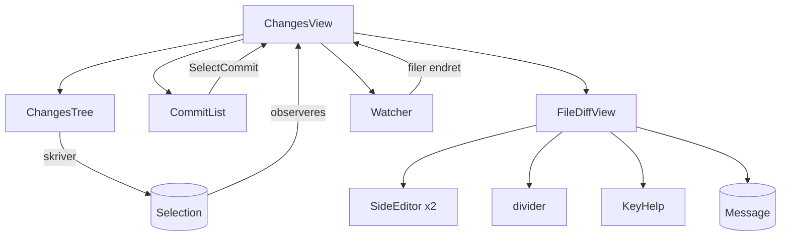

# jetdiff-ui

GPUI-visningen: diffen, filtreet og commit-lista.

## Hvorfor

Dette er laget som tegner. Logikken ligger i `jetdiff-view`, så her er bare det som trenger GPUI: tekst og former, mus og taster, animasjon, zoom og fokus.

Modulene kjenner ikke hverandre. Delt tilstand, som valgt fil, ligger i små GPUI-entiteter som alle observerer. Treet skriver til `Selection` ved klikk, og diffen følger den. `J` og `K` i diffen sender et event som treet flytter valget for.

## Bruk

To visninger er offentlige:

```rust
use jetdiff_ui::{Assets, ChangesView, FileDiffView, Settings, UiTheme, load_font};

Application::new().with_assets(Assets).run(|cx| {
    load_font(cx);
    cx.set_global(Settings { theme: UiTheme::mocha(), folds_open: false });
    // Én fil:
    cx.new(|cx| FileDiffView::standalone(diff, paths, cx));
    // Et repo eller en commit, med tre og commits:
    cx.new(|cx| ChangesView::new(repo, changes, cx));
});
```

`Settings` er en GPUI-global som alle visningene leser. `folds_open` gjør at nye filer vises med alle folds åpne.

Tastene går gjennom `KeyParser` i `jetdiff-view`. Actions som zoom og panelbytte (`ZoomIn`, `FocusLeft`, `ToggleSidePanel` osv.) eksporteres, og den som lager vinduet binder dem til taster.



- `changes_view`: treet og commitene til venstre, diffen til høyre. Henter fra git og laster på nytt når filer endres
- `file_diff`: to `SideEditor` med divider mellom, og tastene
- `help`: tastelinja og popupen med alle tastene
- `side_editor`: tekst, gutter, bakgrunner, ord-markering og error stripe
- `divider`: tegner trakten og fold-koblingene
- `changes_tree`, `commit_list`: listene i sidepanelet
- `message`: kort info eller fast advarsel over tastelinja
- `watcher`: følger working tree med `notify`
- `theme`: Catppuccin Mocha og IntelliJ sine Islands-temaer

## Ressurser

- `fonts/`: JetBrains Mono, bygd inn i appen (SIL Open Font License, se `fonts/OFL.txt`)
- `icons/`: filikoner fra intellij-community (Apache 2.0). Rust-ikonet er fra intellij-rust (MIT, se `icons/LICENSE-intellij-rust.txt`)
