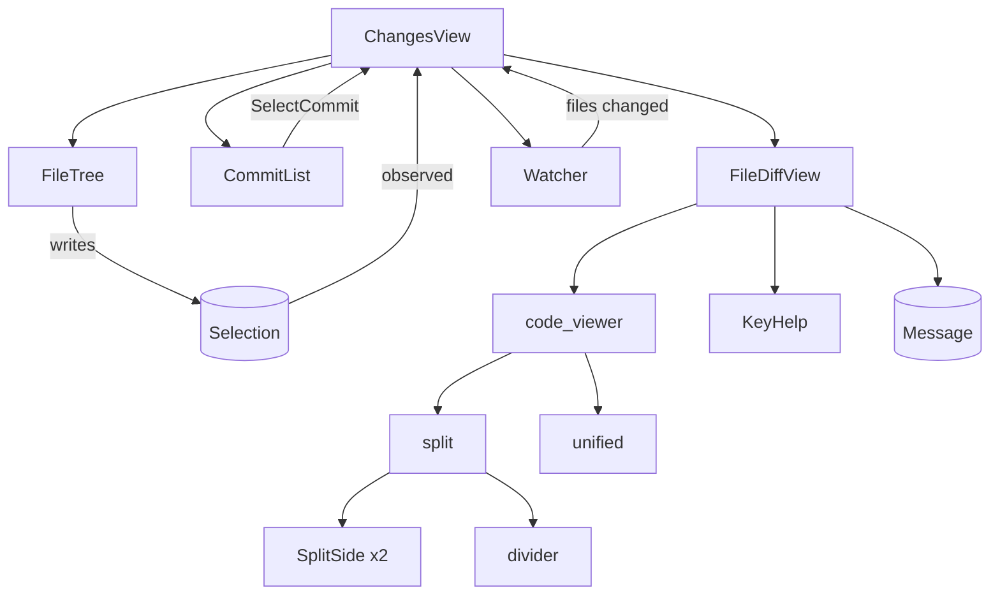

# jetdiff-ui

The GPUI view: the diff, the file tree and the commit list.

## Why

This is the layer that draws. The logic for the diff is in `jetdiff-viewmodel`, and the state around it (changes, reload, tree, commits, watcher) is in `jetdiff-app`. What's here is only what needs GPUI: text and shapes, mouse and keys, animation, zoom, focus, and running the jobs from `jetdiff-app` in the background.

The modules don't know each other. Shared state, like the selected file, lives in small GPUI entities that everyone observes. The tree writes to `Selection` on click, and the diff follows it. `J` and `K` in the diff send an event that the tree moves the selection for.

## Usage

Two views are public:

```rust
use jetdiff_ui::{Assets, ChangesView, FileDiffView, Settings, UiTheme, load_font};

Application::new().with_assets(Assets).run(|cx| {
    load_font(cx);
    cx.set_global(Settings {
        theme: UiTheme::mocha(),
        font_size: 14.,
        collapse_unchanged: true,
        unified: false,
        side_panel_open: false,
    });
    // One file:
    cx.new(|cx| FileDiffView::standalone(diff, paths, cx));
    // A repo or a commit, with the tree and commits:
    cx.new(|cx| ChangesView::new(repo, changed_files, cx));
});
```

`Settings` is a GPUI global that all the views read. `font_size` is where zoom starts, `collapse_unchanged` folds unchanged parts in new files, and `unified` is the diff mode at startup.

The keys go through `KeyParser` in `jetdiff-viewmodel`. Actions like zoom and switching panels (`ZoomIn`, `ToggleView`, `FocusLeft`, `ToggleSidePanel` etc.) are exported, and whoever makes the window binds them to keys.



- `changes_view`: the tree and the commit list on the left, the diff on the right. Runs reload from `jetdiff_app::Changes` in the background and shows the result
- `file_diff`: the diff of one file, Split or Unified. Keys, mouse, zoom and scroll animation
- `code_viewer`: picks Split or Unified for drawing and mouse. Below it are:
  - `split`: two `SplitSide` with the divider between them
  - `split_side`: one side in Split: backgrounds, folds, text and line numbers
  - `divider`: draws the diff divider and the fold links
  - `unified`: one code view with old and new line numbers
  - `code_paint`: what both diff modes draw the same way
- `help`: draws the keymap bar and the popup. The keys are in `jetdiff_app::help`
- `file_tree`, `commit_list`: the lists in the side panel, over `Files` and `Commits` from `jetdiff-app`
- `message`: a brief info or pinned warning above the keymap bar
- `watcher`: polls `jetdiff_app::Watcher` on the GPUI executor
- `theme`: Catppuccin Mocha and IntelliJ's Islands themes

## Resources

- `fonts/`: JetBrains Mono, built into the app (SIL Open Font License, see `fonts/OFL.txt`)
- `icons/`: file icons from intellij-community (Apache 2.0). The Rust icon is from intellij-rust (MIT, see `icons/LICENSE-intellij-rust.txt`)
