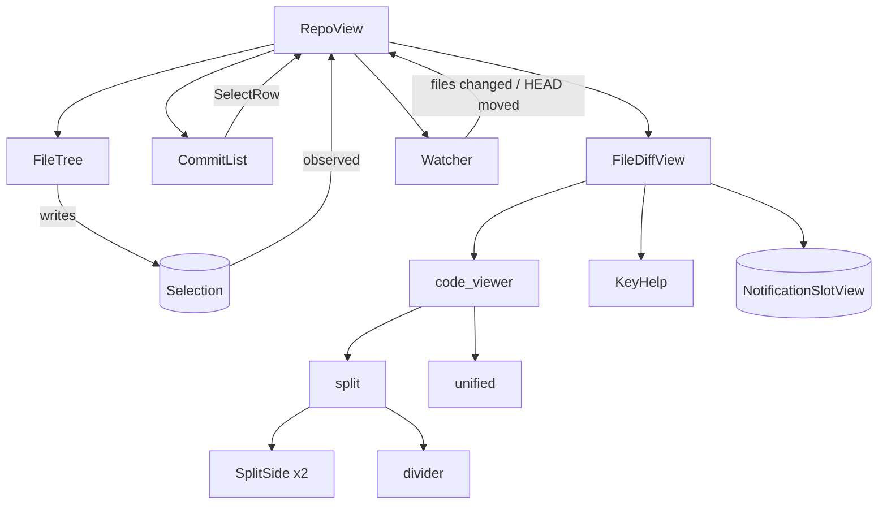

# jetdiff-ui

The GPUI view: the diff, the file tree and the commit list.

## Why

This is the layer that draws. The logic for the diff is in `jetdiff-viewmodel`, and the state around it (repo source, tree, commits, watcher) is in `jetdiff-app`. What's here is only what needs GPUI: text and shapes, mouse and keys, animation, zoom, focus, and running the jobs from `jetdiff-app` in the background.

The modules don't know each other. Shared state, like the selected file, lives in small GPUI entities that everyone observes. The tree writes to `Selection` on click, and the diff follows it. `J` and `K` in the diff send an event that the tree moves the selection for.

## Usage

Two views are public:

```rust
use jetdiff_ui::{Assets, FilePairView, Quit, RepoView, Settings, key_bindings, load_font};

let config = jetdiff_app::config::load()?;
Application::new().with_assets(Assets).run(move |cx| {
    load_font(cx);
    cx.set_global(Settings::new(&config, env!("CARGO_PKG_VERSION")));
    cx.bind_keys(key_bindings());
    cx.on_action(|_: &Quit, cx| cx.quit());
    // A File pair:
    cx.new(|cx| FilePairView::new(file_pair, diff, cx));
    // A repo source, with the tree and commits:
    cx.new(|cx| RepoView::new(repo_source, commits, cx));
});
```

`Settings` is a GPUI global that all the views read. The version is shown at the right of the keymap bar, and it is the version of the app that shows the views. `font_size` is where zoom starts, `fold_unchanged` closes the folds in each file that is loaded, and `unified` is the diff mode at startup.

The keys go through `KeyParser` in `jetdiff-viewmodel`. The keys outside the diff, like zoom, moving focus and source reload, are actions (`ZoomIn`, `FocusLeft`, `SourceReload` etc.). `key_bindings` binds them under `KEY_CONTEXT`, which both views set, so they only apply when the focus is inside the view. The views don't handle `Quit`: the standalone app quits, and an app that embeds the view can close it instead.



- `repo_view`: the tree and the commit list on the left, the diff on the right. Runs the read jobs from `jetdiff_app::RepoSource` in the background and applies the result
- `file_diff`: the diff of one file, Split or Unified. Keys, mouse, zoom and scroll animation
- `file_pair_view`: the diff of a File pair, read again on a source reload
- `code_viewer`: picks Split or Unified for drawing and mouse. Below it are:
  - `split`: two `SplitSide` with the divider between them
  - `split_side`: one side in Split: backgrounds, folds, text and line numbers
  - `divider`: draws the diff divider and the fold links
  - `unified`: one code view with a line number column per side
  - `code_paint`: what both diff modes draw the same way
- `help`: draws the keymap bar and the popup. The keys are in `jetdiff_app::help`
- `file_tree`, `commit_list`: the lists in the side panel, over `Files` and `Commits` from `jetdiff-app`
- `notification_slot_view`: the pinned notification, with a brief one over it for a while, above the keymap bar
- `watcher`: polls `jetdiff_app::Watcher` on the GPUI executor
- `theme`: the built-in theme from `jetdiff-viewmodel` translated to GPUI colors

## Resources

- `fonts/`: JetBrains Mono, built into the app (SIL Open Font License, see `fonts/OFL.txt`)
- `icons/`: file icons from intellij-community (Apache 2.0). The Rust icon is from intellij-rust (MIT, see `icons/LICENSE-intellij-rust.txt`)
