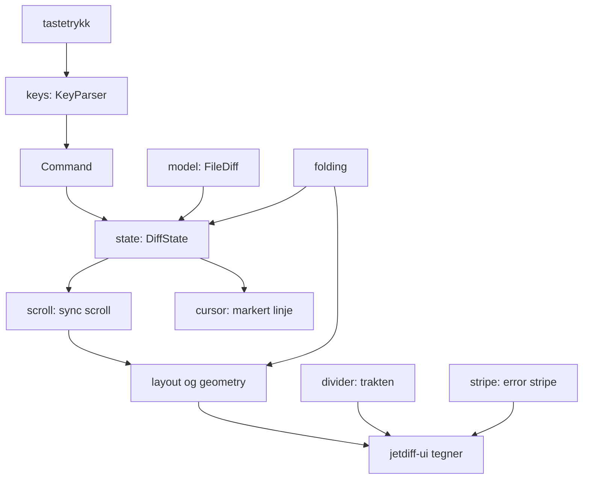

# jetdiff-view

Visningsmodellen for diffen av én fil: scroll, folding, markert linje, taster og geometri.

## Hvorfor

Det meste av det som gjør diffen i IntelliJ god, er logikk og ikke tegning. Sidene scroller i takt med et anker 1/3 ned, uendrede linjer foldes parvis på begge sider, trakten mellom sidene har bestemte kurver. Alt dette ligger her, uten GUI, så det kan testes uten vindu.

`jetdiff-ui` tegner bare det denne craten regner ut. Geometrien er i piksler, klar til å tegnes.

## Bruk

```rust
use jetdiff_view::{
    ComparisonPolicy, DiffState, FileDiff, Folding, KeyParser, Language, Parsed,
};

let mut diff = FileDiff::new(left, right, ComparisonPolicy::Default)?;
diff.highlight_syntax(Language::Rust);
let folding = Folding::new(&diff);

let mut state = DiffState::new(diff.into(), folding.into());
state.init(viewport);

let mut keys = KeyParser::default();
if let Parsed::Command(cmd) = keys.feed(key) {
    state.execute(cmd, viewport, horizontal);
}
// state.scroll er målet. UI-et animerer dit og tegner.
```



- `model`: blokker, linjer og syntaks per side
- `state`: samler markert linje, folding og scroll, og utfører `Command`
- `scroll`: master-siden scroller, den andre regnes ut i samme frame
- `folding`: uendrede linjer foldes, felles for begge sider
- `layout`, `geometry`: vertikal og horisontal plassering per side
- `divider`, `separator`, `stripe`: trakten, bølgen på folds og error stripe
- `keys`, `command`: keymap og kommandoene det gir
- `theme`, `metrics`: farger og linjehøyde som IntelliJ

Mange moduler er porter av bestemte klasser i IntelliJ, og navnet står øverst i fila. Research ligger i [`docs/research/`](../../docs/research).

## Tester

```
cargo test -p jetdiff-view
```
