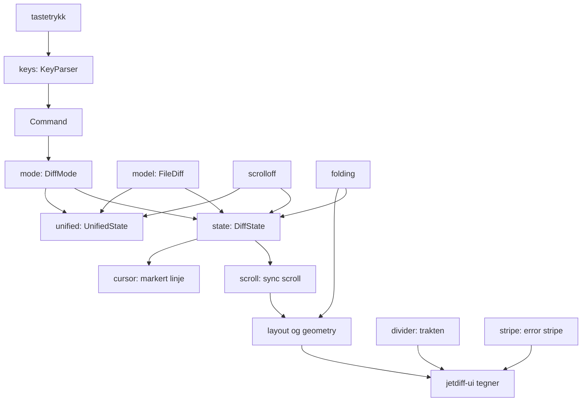

# jetdiff-viewmodel

Visningsmodellen for diffen av én fil, split eller unified: scroll, folding, markert linje, taster og geometri.

## Hvorfor

Det meste av det som gjør diffen i IntelliJ god, er logikk og ikke tegning. Sidene scroller i takt med et anker 1/3 ned, uendrede linjer foldes parvis på begge sider, trakten mellom sidene har bestemte kurver. Alt dette ligger her, uten GUI, så det kan testes uten vindu.

`jetdiff-ui` tegner bare det denne craten regner ut. Geometrien er i piksler, klar til å tegnes.

`model` (`FileDiff`) er diffdataene for én fil. De ligger her fordi de er bygd for visning: syntaks, ord-markering og linjemappingen sync scroll bruker.

## Bruk

```rust
use jetdiff_viewmodel::{
    ComparisonPolicy, DiffMode, FileDiff, Folding, KeyParser, Language, Parsed,
};

let mut diff = FileDiff::new(left, right, ComparisonPolicy::Default)?;
diff.highlight_syntax(Language::Rust);
let folding = Folding::new(&diff);

// Nye og slettede filer blir unified uansett
let mut mode = DiffMode::new(diff.into(), folding.into(), unified);
mode.init(viewport);

let mut keys = KeyParser::default();
if let Parsed::Command(cmd) = keys.feed(key) {
    mode.execute(cmd, viewport, horizontal);
}
// mode.scroll() er målet. UI-et animerer dit og tegner.

// `v`: cursoren blir på samme linje og høyde
mode.toggle(Folding::new(mode.diff()).into(), viewport);
```



- `model`: blokker, linjer og syntaks per side
- `mode`: split eller unified, og byttet mellom dem
- `state`: split. Samler markert linje, folding og scroll, og utfører `Command`
- `unified`: rader over `FileDiff` der slettede linjer står over de nye, og tilstanden for dem. Ingen folding
- `scrolloff`: hvor cursoren kan stå uten å scrolle, felles for begge
- `scroll`: master-siden scroller, den andre regnes ut i samme frame
- `folding`: uendrede linjer foldes, felles for begge sider
- `layout`, `geometry`: vertikal og horisontal plassering per side, og unified med to nummerkolonner
- `divider`, `separator`, `stripe`: trakten, bølgen på folds og error stripe
- `keys`, `command`: keymap og kommandoene det gir
- `theme`, `metrics`: farger og linjehøyde som IntelliJ

Mange moduler er porter av bestemte klasser i IntelliJ, og navnet står øverst i fila. Research ligger i [`docs/research/`](../../docs/research).

## Tester

```
cargo test -p jetdiff-viewmodel
```
