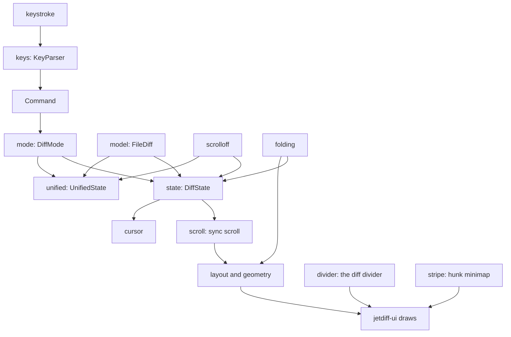

# jetdiff-viewmodel

The view model for the diff of one file, Split or Unified: scroll, folding, cursor, keys and geometry.

## Why

Most of what makes the diff in IntelliJ good is logic, not drawing. The sides scroll in step with an anchor 1/3 down, unchanged lines are folded in pairs on both sides, and the diff divider between the sides has specific curves. All of that lives here, without a GUI, so it can be tested without a window.

`jetdiff-ui` only draws what this crate computes. The geometry is in pixels, ready to draw.

`model` (`FileDiff`) is the diff data for one file. It lives here because it is built for display: syntax, inline highlights and the line mapping sync scroll uses.

## Usage

```rust
use jetdiff_viewmodel::{
    ComparisonPolicy, DiffMode, FileDiff, Folding, KeyParser, Language, Parsed,
};

let mut diff = FileDiff::new(left, right, ComparisonPolicy::Default)?;
diff.highlight_syntax(Language::Rust);
let folding = Folding::new(&diff);

// Added and deleted files become Unified regardless
let mut mode = DiffMode::new(diff.into(), folding.into(), unified);
mode.init(viewport);

let mut keys = KeyParser::default();
if let Parsed::Command(cmd) = keys.feed(key) {
    mode.execute(cmd, viewport, horizontal);
}
// mode.scroll() is the target. The UI animates there and draws.

// `v`: the cursor stays on the same line and height
mode.toggle(Folding::new(mode.diff()).into(), viewport);
```



- `model`: hunks, lines and syntax per side
- `mode`: Split or Unified, and switching between them
- `state`: Split. Brings together the cursor, folding and scroll, and carries out `Command`
- `unified`: rows over `FileDiff` where deleted lines sit above the added ones, and the state for them. No folding
- `scrolloff`: where the cursor can be without scrolling, shared by both
- `scroll`: the master side scrolls, and the other is computed in the same frame
- `folding`: unchanged lines are folded, shared by both sides
- `layout`, `geometry`: vertical and horizontal placement per side, and Unified with two number columns
- `divider`, `separator`, `stripe`: the diff divider, the wave on folds and the hunk minimap
- `keys`, `command`: the keymap and the commands it gives
- `theme`, `metrics`: colors and line height like IntelliJ

Many modules are ports of specific classes in IntelliJ, and the name is at the top of the file. Research is in [`docs/research/`](../../docs/research).

## Tests

```
cargo test -p jetdiff-viewmodel
```
