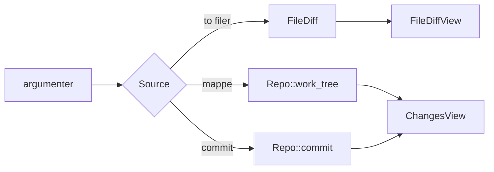

# jetdiff

Binæren. Leser argumentene og config-fila, laster innholdet og åpner vinduet.

## Hvorfor

Alt annet er biblioteker som ikke antar noe om appen rundt. Det er fordi diff-viewen skal kunne bli en modul i et større verktøy. Denne craten er det eneste stedet som bestemmer hvordan jetdiff startes: argumenter og config-fil.

## Bruk

```
cargo run --release -p jetdiff -- [<mappe> | <commit> | <pr-lenke> | <venstre> <høyre>]
```

Se hoved-[README](../../README.md) for argumentene, innstillingene og tastene.



Innholdet lastes før vinduet åpnes, så feil som ukjent commit skrives til terminalen med exit-kode 1. Feil i argumentene eller config-fila gir exit-kode 2.

Tastene som ikke går gjennom vim-parseren i `jetdiff-viewmodel` ligger i `jetdiff_app::keys`. `bind_keys` i `main.rs` gjør dem til GPUI-bindinger.
