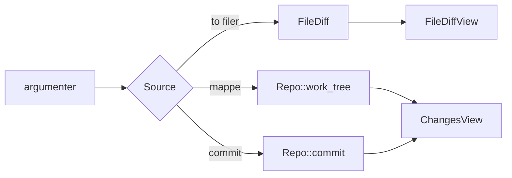

# jetdiff

Binæren. Leser argumentene, laster innholdet og åpner vinduet.

## Hvorfor

Alt annet er biblioteker som ikke antar noe om appen rundt. Det er fordi diff-viewen skal kunne bli en modul i et større verktøy. Denne craten er det eneste stedet som bestemmer hvordan jetdiff startes: argumenter, tema og tastebindinger.

## Bruk

```
cargo run --release -p jetdiff -- [<mappe> | <commit> | <venstre> <høyre>] [--theme <tema>]
```

Se hoved-[README](../../README.md) for argumentene og tastene.



Innholdet lastes før vinduet åpnes, så feil som ukjent commit skrives til terminalen med exit-kode 1. Feil i argumentene gir exit-kode 2.

Tastebindinger som ikke går gjennom vim-parseren i `jetdiff-view` ligger i `bind_keys` i `main.rs`: zoom, kontekst, panelbytte, `b` og avslutt.
