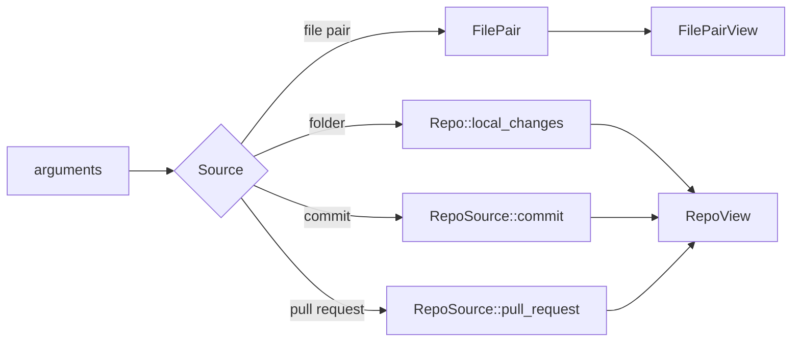

# jetdiff

The binary. Reads the arguments and the config file, reads the source and opens the window or the terminal view.

## Why

Everything else is libraries that assume nothing about the app around them. That's because the diff view should be able to become a module in a larger tool. This crate is the only place that decides how jetdiff starts: arguments and config file.

## Usage

```
cargo run --release -p jetdiff -- [--tui] [<folder> | <commit> | <pr-link> | <left-side> <right-side>]
```

`gui.rs` and `tui.rs` are behind the features with the same names. `--tui` picks the terminal; otherwise the window is used when `gui` is built in.

See the main [README](../../README.md) for the arguments, settings and keys.



The source is read before the window opens, so errors like an unknown commit are written to the terminal with exit code 1. Errors in the arguments or the config file give exit code 2.

The keys that don't go through the vim parser in `jetdiff-viewmodel` are in `jetdiff_app::keys`. `bind_keys` in `gui.rs` turns them into GPUI bindings.
